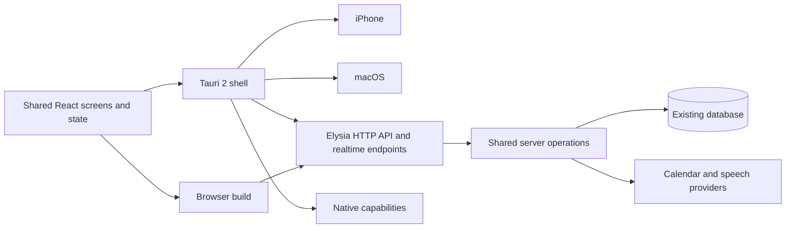

# Todalo migration to Tauri 2

Status: implementation specification; work started on `codex/tauri-migration`. Technology choice: Tauri 2.
Date: 4 October 2026.

## 1. Outcome and constraints

Ship installable iPhone and macOS applications while retaining the browser app, using one shared React interface and one server implementation of product rules. Preserve Todalo's current visual identity, layouts, typography, icons, colors, and interactions. Adapt to safe areas, touch, software keyboards, and desktop windows without redesigning the product.

The user has selected Tauri and wants future Duolingo-style animations and controllable haptic patterns. Those requirements inform the platform boundary; producing animation assets or a custom haptic engine is not part of the initial migration.

The migration must:

- Preserve existing accounts, tasks, projects, attachments, preferences, calendar connections, and Ramble behavior.
- Retain a working web deployment throughout the transition.
- Share screen and component implementations across browser, iPhone, and Mac.
- Keep database access, Google credentials, speech/LLM secrets, and authoritative business logic on the server.
- Produce signed, installable builds and verify critical flows on an actual iPhone and Mac before declaring completion.

Initial scope excludes Android/Windows releases, offline mutation synchronization, widgets, push reminders, share extensions, background microphone recording, and a visual redesign. Platform choices should not prevent those later. These exclusions are proposed scope defaults, not claims that Tauri cannot support them.

## 2. Architecture decision

Use **React + TypeScript + Vite** for a client-rendered application, built for the browser and bundled into a **Tauri 2** shell for iOS and macOS. Keep the existing Elysia/Bun service and PostgreSQL/Drizzle backend; expand its API to serve all clients. Retain Bun workspaces and Turborepo.

Tauri recommends a static frontend and a separate API, and recommends Vite for React SPAs. The packaged production apps must load bundled assets, not depend on loading the hosted website as their application shell. [Tauri frontend guidance](https://tauri.app/start/frontend/), [Vite integration](https://tauri.app/start/frontend/vite/)

Do not bundle a Next.js, Bun, or Node server inside the app. Do not rewrite the backend in Rust. Rust owns Tauri setup and native integration glue; Swift is introduced only for capabilities that require an iOS implementation.

Proposed final layout:

| Path | Responsibility |
| --- | --- |
| `apps/client` | One Vite/React frontend: screens, components, routing, query state, assets, platform adapters |
| `apps/client/src-tauri` | Tauri configuration, Rust entry point, permissions, Apple projects and native plugins |
| `apps/api` | HTTP endpoints, Better Auth handler, Ramble WebSockets, calendar callbacks/streaming |
| `packages/server` | Framework-independent server operations extracted from Next code; server-only |
| `packages/contracts` | Client-safe request/response schemas, DTOs and API error definitions |
| `packages/ramble` | Existing pure TypeScript parsing, recurrence and Ramble logic |
| `packages/auth` | Existing server auth configuration, extended for native sessions |
| `packages/db` | Existing schema, migrations and database access |
| `apps/web` | Temporary legacy Next application; removed after browser cutover and rollback window |

Avoid additional packages until they have a real consumer. Keep platform adapters in `apps/client` initially. The temporary coexistence of old and new clients must have an exit condition: remove the legacy UI after parity and production validation, rather than maintaining two frontend products indefinitely.

## 3. Current code and migration map

The inspected app uses Next.js 16.2.10, React 19.2.4, Tailwind, Base UI/shadcn, and dnd-kit. `apps/web/next.config.ts` uses standalone server output. Existing pages perform authenticated server reads and mutations use Server Actions. This is not a static-export application today.

| Existing surface | Required migration |
| --- | --- |
| `apps/web/app/(app)/tasks/actions.ts` | Extract create/update/delete/complete/bulk/reorder operations into server services; expose authenticated API endpoints |
| `tasks/metadata-actions.ts` | Move editor data, metadata, labels, saved filters and bulk metadata operations behind the API |
| `projects/actions.ts`, `projects/organization-actions.ts` | Preserve projects, sections, moves, parent relationships and ownership checks |
| `settings/actions.ts`, `settings/keyboard-actions.ts` | Preserve calendar controls, smart dates and account keyboard preferences |
| `apps/web/lib/tasks.ts`, `organization.ts`, other server reads in pages/layouts | Replace direct client dependencies with typed API queries |
| `apps/web/components`, `app/globals.css`, assets and client-safe helpers | Reuse in the shared client; replace Next-specific imports and server-action calls |
| `apps/web/app/api/auth/[...all]/route.ts` | Mount Better Auth on Elysia while preserving existing account/session data and callback paths |
| Attachment routes and `lib/attachments.ts` | Move handlers behind API; preserve size limits, ownership, metadata and stored bytes |
| Calendar webhook/stream routes and calendar libraries | Move to API/server services; preserve externally registered callback URLs |
| `apps/api/src/app.ts` and Ramble services | Retain server protocol and processing; adapt native authentication and connection lifecycle |

Complete an operation inventory in phase 0, including queries embedded directly in page components. The table is a map of known boundaries, not an exhaustive list of every function.

Next's installed static-export guide excludes Server Actions and request-dependent features. Simply changing `output` is insufficient. Before implementation, follow repository instructions to read the installed Next and Turborepo guides relevant to any configuration or command changes. [Installed Next export guide](../node_modules/next/dist/docs/01-app/02-guides/static-exports.md)

## 4. Frontend and visual parity

Use React Router for client routing and TanStack Query for remote state. Resolve compatible versions during implementation, pin them through the existing lockfile, and read their current documentation before adopting APIs. These are proposed dependencies, not packages already present.

Preserve existing route meanings: login, inbox, today, upcoming, projects/project detail, task detail, labels/label detail, saved filters/filter detail, search, settings, and root/home redirects. Keep bookmarks and task URLs usable. Host browser routes with an HTML fallback that never swallows API or asset requests. Map incoming native deep links to the same internal routes, including when the app is cold-started or the user must sign in first.

Replace Next navigation, server layouts, `router.refresh`, and `revalidatePath` behavior with client routing and query invalidation. Enumerate affected query keys for each mutation, including sidebar counts, task detail, project views and calendar views. Clear user-scoped caches on logout/account change. Preserve draft input during recoverable failures.

Reuse existing markup, CSS, fonts, and components. Audit `next/font`, `next/image`, `next/link`, environment variables, absolute URLs, server imports, and any Node-only dependencies. Bundle required fonts and assets; only public configuration may enter the client build. Keep dates, recurrence, timezone and locale behavior unchanged, using explicit JSON serialization rather than relying on Server Action transport.

Capture baseline screenshots before moving screens, at matched viewport sizes and deterministic data. Compare Mac/browser screens against the desktop baseline and iPhone screens against the existing responsive design. Intentional differences are limited to safe-area spacing, usable touch targets, keyboard accommodation and native window chrome; document them. Do not promise pixel identity across OS font rendering.

Verify focus, dialogs, pickers, drag/drop, touch scrolling, selection, paste, keyboard shortcuts, VoiceOver and reduced-motion behavior in actual WKWebView builds. Preserve desktop shortcuts without making essential actions keyboard-only on iPhone.

## 5. API and business rules

Introduce `/api/v1` endpoints for new application operations; preserve existing auth, calendar webhook and Ramble paths where compatibility requires it. Use resource-oriented reads/writes plus explicit commands for completion, bulk actions, task movement and reordering.

| API group | Required coverage |
| --- | --- |
| Bootstrap and task queries | Current user, navigation counts, metadata, tasks, task detail/editor data, search and view filters |
| Task commands | Create, edit, delete, complete, recurrence, reorder, bulk operations, metadata, hierarchy and moves |
| Organization | Projects, sections, labels, saved filters and destination lookup |
| Settings | Smart-date settings, keyboard preferences, calendar accounts/visibility, resync and disconnect |
| Attachments | Existing file-task creation, attachment listing and authenticated download |
| Calendar | Event reads, provider webhook handling, change notifications and refresh |
| Ramble | Session setup, audio transport, staging, commit and error/reconnect behavior |

`packages/server` functions accept an authenticated user ID and validated input; they must not depend on Next request context or cache APIs. Legacy Server Actions become thin wrappers over those functions during migration. New Elysia handlers call the same functions. Never duplicate recurrence advancement or calendar-write logic in the two transports.

Define client-safe schemas for IDs, dates, nullable fields, enum values and pagination where needed. Return consistent errors with a code, safe message, optional field errors and request ID. Preserve authorization at every resource boundary. Treat inaccessible resource IDs consistently; never rely on hiding UI as access control.

Specify transaction boundaries for existing multi-row mutations. Avoid automatic retries for non-idempotent operations unless an operation ID prevents duplicate effects. Task creation, recurrence completion and Ramble commits must survive ambiguous responses without silently creating duplicates; define and test operation-ID storage before enabling those retries. Keep provider side-effect handling explicit so an HTTP retry does not duplicate calendar events.

## 6. Authentication, origins and deep links

Keep Better Auth and the current user/account/session database. Browser requests continue using secure same-origin cookies. For native clients, the target is Better Auth-backed bearer sessions, stored through an OS-protected credential adapter and attached by the native HTTP transport. Better Auth provides a bearer plugin, but the complete native flow is a **phase-1 feasibility gate**, not something the current app already implements. [Better Auth bearer plugin](https://better-auth.com/docs/plugins/bearer)

The gate must prove email/password login, current-user lookup, expiry, logout/revocation, restart persistence, Google sign-in/account linking, and authenticated HTTP, uploads, downloads and realtime connections on both platforms. Keep session secrets out of localStorage, ordinary Tauri store files, URLs and logs. Select and validate a credential-storage implementation for both Apple targets before finishing this phase; a plaintext fallback is not acceptable.

Use the system browser/native authentication session for provider authorization. Preserve server-side Google callbacks and calendar token storage. Returning to the app uses a short-lived, single-use handoff code bound to the initiating client through a verifier/challenge and state; exchange it over HTTPS for the app session. Never put a reusable session or Google token in a callback URL. Define allowed redirect destinations, replay/expiry behavior, linking vs sign-in behavior, and cancellation recovery. This handoff is application work unless a verified integration supplies it.

Use an owned-domain universal link where appropriate and a registered application scheme for development/fallback. Confirm cold-start and already-open behavior separately. Tauri provides a deep-link plugin, but associated domains, signing and callback registrations still need configuration. [Tauri deep links](https://v2.tauri.app/plugin/deep-linking/)

Native webview origins differ from the hosted site's origin. Configure exact environment-specific CORS/trusted-origin rules after observing development and production origins on both platforms. Preserve CSRF protection for cookie-authenticated mutations. Do not solve native compatibility with wildcard credentialed CORS or by disabling checks globally. Attachment uploads and Ramble currently contain explicit origin checks and need deliberate changes.

Browser WebSocket/EventSource APIs cannot be assumed to attach arbitrary bearer headers. For Ramble, choose and prove either a native transport that can authenticate the handshake or a short-lived, single-use socket ticket issued over authenticated HTTPS. Keep browser cookie sessions and origin validation working. For calendar events, use a header-capable streaming client or a tested native transport. Refresh on focus/resume/reconnect even when a stream is present; do not promise event delivery while iOS suspends the application.

## 7. Native capabilities and lifecycle

Provide a small typed platform adapter covering external URLs/deep links, credentials, authenticated transport where necessary, file selection/download, microphone lifecycle and feedback. Components call these capabilities instead of scattering Tauri checks through screens. Browser implementations must work without the Tauri runtime.

Tauri commands/plugins receive only the permissions needed by these features. Bundle a restrictive CSP that allows the configured API/WebSocket endpoints and required assets. Open external websites in the system browser; do not grant privileged app capabilities to arbitrary remote pages. Store public environment endpoints separately from signing secrets and server credentials.

**Ramble:** initially test the existing Web Audio capture in WKWebView. Verify required microphone usage descriptions/entitlements, explicit permission denial, actual sample rate and conversion to the server's expected format, audio ordering, latency, interruptions and resource cleanup. If reliable capture cannot be achieved, add a narrow native audio adapter without changing the shared Ramble screens. On backgrounding or interruption, stop or safely pause recording and show an accurate recoverable state. No background recording in this release.

**Files:** retain upload limits and ownership checks. Verify iPhone file selection, Mac drag/drop/paste, authenticated attachment downloads, cancellation and large-file errors. Browser blob URLs, native filesystem paths and server URLs must not be treated as interchangeable.

**Calendar:** preserve existing sync semantics and credentials. Move webhook processing and notification publication together: the current notification helper is process-local, so separating publisher and subscriber across processes would lose events. For the initial single API instance keep them together; introduce shared pub/sub if deploying multiple instances. Refetch after app resume and retain registered webhook URL compatibility during rollout.

## 8. Animations and haptics

Keep animation rendering in the shared React frontend. Existing transitions remain; Rive is a candidate for future interactive characters and celebrations, not a mandatory migration dependency. Bundle animation/runtime assets and verify CSP and device performance when introduced. Respect reduced motion and avoid tying task persistence to an animation completing. [Rive web runtime](https://rive.app/docs/runtimes/web/web-js)

Introduce a semantic feedback boundary, for example selection, task completion and goal achievement, with a browser/Mac no-op fallback where unsupported. Feedback failure must never fail a task operation. Provide an opt-out when haptics are enabled.

The official Tauri haptics plugin can provide standard iOS feedback. Future custom patterns may use a focused Swift plugin with Core Haptics and bundled AHAP assets, controlling event timing, duration, intensity and sharpness. The native engine schedules the pattern; do not depend on JavaScript timers for precise pulse timing. Check hardware support and lifecycle interruptions. Arbitrary iPhone patterns are not promised on a Mac trackpad. [Tauri haptics](https://v2.tauri.app/plugin/haptics/), [Tauri mobile plugins](https://v2.tauri.app/develop/plugins/develop-mobile/), [Core Haptics](https://developer.apple.com/documentation/corehaptics)

Initial migration acceptance requires the adapter boundary and a device-verified standard haptic smoke test. Custom pattern authoring and animated characters are follow-up features.

## 9. Connectivity and multi-device consistency

Release 1 remains server-backed and requires connectivity for reads and writes. Bundling the UI does not make the product offline-first. Render a clear connection state and a retry action; never report an unsaved task as persisted. Do not add a durable offline mutation queue during this migration.

Refresh relevant queries after successful mutation, foregrounding and reconnection. While active, refetch task views periodically (initial proposal: every 30 seconds) so changes on another device appear without a manual reload. Existing calendar events should invalidate affected queries immediately when delivered. Stop polling when hidden/backgrounded. Preserve editor drafts and avoid silently replacing an active edit; surface a conflict or stale-data state when the server rejects it. Formal offline merge semantics are a separate project.

## 10. Build, distribution and rollout

Build browser assets once per release/environment and bundle the shared frontend for the Apple apps. Separate development, staging and production endpoints and identifiers. Pin the chosen Tauri 2/Rust/JavaScript toolchain and commit relevant lockfiles. Add workspace tasks only after reading the installed Turbo documentation.

Proposed delivery defaults: iPhone via TestFlight, then App Store; macOS via signed/notarized direct distribution initially, with Mac App Store optional later. iOS builds require macOS/Xcode. Release setup includes Apple team access, bundle identifiers, deployment targets, supported Mac architectures, provisioning, microphone entitlements, icons, privacy declarations and store metadata. Record concrete minimum OS versions and architecture targets after the phase-1 device/toolchain check; do not claim an untested support matrix. [Tauri prerequisites](https://tauri.app/start/prerequisites/), [App Store distribution](https://tauri.app/distribute/app-store/), [macOS signing](https://tauri.app/distribute/sign/macos/)

Use store-distributed updates on iOS. Direct Mac builds may initially use manual signed releases; a signed updater can be separately added. Frontend changes ship in app releases, so the API must remain compatible with already installed clients. Maintain `/api/v1` compatibility for the supported client window, document that window before release, and show an actionable upgrade message for unsupported versions.

Deploy API additions first. Keep old Next paths functioning while clients move. Preserve callback URLs through routing rather than requiring all calendar connections to be recreated. Use additive database migrations and avoid destructive schema changes until the rollback window ends.

At browser cutover, deploy SPA assets with route fallback and API proxying; retain the last Next deployment as the rollback target. Rollback restores the previous browser routing/build and compatible server deployment without undoing user data. Installed native clients must continue to work during rollback. Retirement requires a documented compatibility and data check, not merely a successful frontend build.

## 11. Implementation phases and exit gates

| Phase | Deliverable | Exit gate |
| --- | --- | --- |
| 0. Baseline | Feature/operation inventory, representative data, visual captures, current test results and route map | Every existing feature assigned a migration and validation owner; pre-existing failures recorded |
| 1. Feasibility | Vite/Tauri shell with one real Today flow, sign-in, API query/mutation, secure sessions, OAuth return, microphone/socket and haptic probes | Signed development builds tested on Mac and physical iPhone; no unresolved auth/storage/audio blocker |
| 2. Shared backend | Contracts, extracted server operations, Elysia endpoints, legacy wrappers and moved auth/calendar/attachment handlers | Legacy web passes regression checks; new endpoints preserve permissions and mutation semantics |
| 3. Shared frontend | All screens migrated with routes, query state and platform adapters | Feature and visual parity in browser and Apple builds; no client server-only imports |
| 4. Release hardening | Lifecycle handling, signing, release configuration and compatibility behavior | Install/update/relaunch tests pass; critical device and security cases pass |
| 5. Rollout and retirement | TestFlight/Mac pilot, browser cutover, monitored release, rollback evidence | Stable pilot and parity sign-off; remove legacy Next UI only after rollback window |

Phase 1 deliberately implements one narrow end-to-end slice before broad extraction. Migration PRs should group complete feature slices, preserve deployability, and avoid unrelated refactors. This specification does not authorize publishing store submissions or changing production routing by itself.

## 12. Verification and completion criteria

Run existing relevant unit/integration tests and carry their behavioral assertions into the new boundaries. Add tests for API authorization, serialization, idempotent retries, session expiry, callbacks and ownership. Test business behavior rather than merely reproducing the new function structure.

The migration is complete only when:

- One shared screen implementation serves browser, iOS and macOS; no long-term duplicate Next UI remains.
- Existing data/accounts work without a reset; calendar credentials and attachment contents survive migration.
- Every route and operation in the phase-0 inventory has passed feature validation, including recurrence, task hierarchy, bulk edits, filters, keyboard preferences and calendar settings.
- Visual comparisons show preserved design, with intentional platform accommodations recorded.
- Physical iPhone and Mac builds pass sign-in/provider linking, relaunch, logout, task creation/completion, attachment handling, Ramble, permission denial, deep links and foreground recovery.
- A change on one device appears on another through the defined refresh behavior; failed writes are visibly failed and retries do not duplicate tasks/recurrence effects.
- Unsupported/disabled haptics safely do nothing; standard iPhone feedback works without blocking persistence.
- Cross-user API access, upload-origin handling, expired sessions and replayed callback/socket credentials have negative coverage.
- Client bundles contain no server modules or secrets; release configuration grants only required native capabilities.
- Browser production routing, signed Apple distribution, backend compatibility and rollback have been exercised and documented.

Unit/browser automation cannot substitute for WKWebView, microphone, haptic and lifecycle validation on hardware. Record device model, OS, app build and observed results in `docs/qa/`.

## 13. Decisions to finalize during implementation

These do not block writing or reviewing this specification, but each must be resolved before its dependent phase closes:

| Decision | Default / resolution point |
| --- | --- |
| Apple identity and app branding | Reuse Todalo branding; confirm team, identifiers and owned callback domain in phase 1 |
| Minimum OS and Mac architectures | Establish a supported matrix using actual target hardware and plugin requirements in phase 1 |
| Native auth/storage and realtime transport | Validate bearer sessions, protected storage, OAuth handoff and stream/socket mechanism before broad UI migration |
| Mac distribution | Direct signed/notarized pilot; confirm store requirements before release |
| Offline expectations | Online-only migration; offline edits require an explicit later specification |
| API support and rollback window | Set a concrete release policy before phase 4 completes |
| Animation tooling and custom haptic assets | Defer to a later interaction-design task; retain the adapter boundary now |

## 14. Relationship to earlier research

This specification supersedes the provisional SwiftUI recommendation in [the earlier strategy note](research/native-app-strategy-2026-10-04.md). The user's subsequent requirements—preserve the existing interface, share frontend code, and add animation/haptics—establish Tauri as the chosen approach. The [source comparison](research/native-platform-options-sources.md) remains background context.

This change is documentation only. No dependencies, runtime code, native projects, database schema or deployment configuration have been changed or tested as part of writing this specification.
